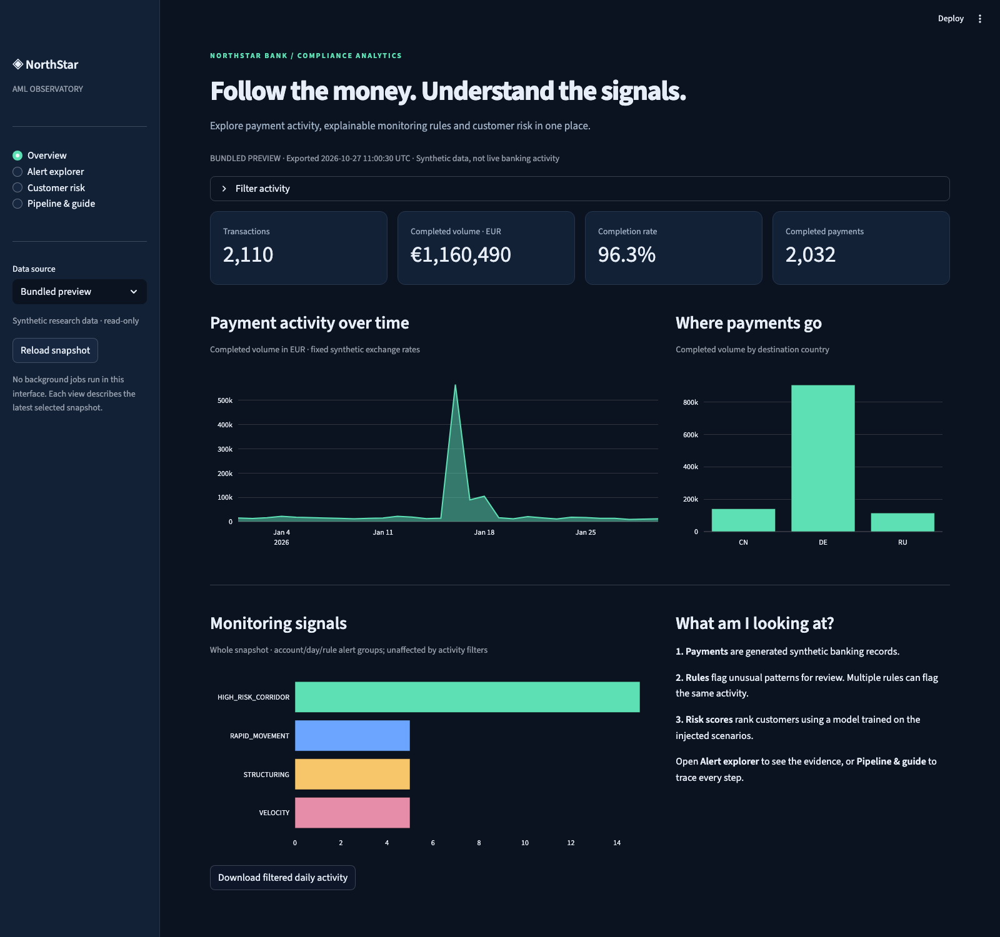
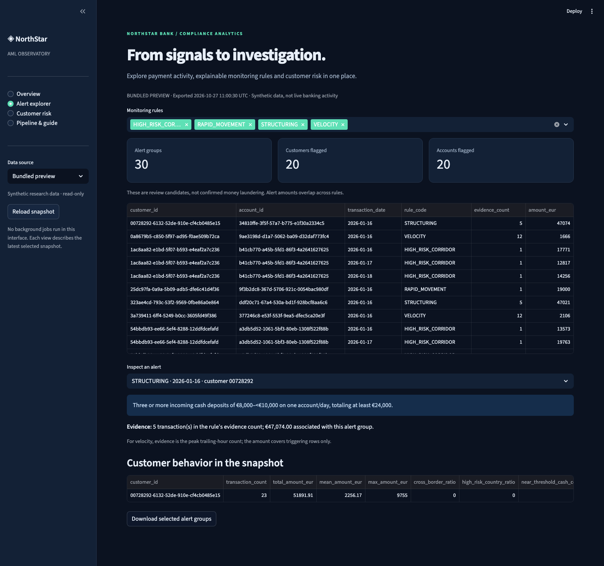

# 🏦 Enterprise AML Compliance Platform

**Follow the money. Understand the signals.**

An end-to-end synthetic banking analytics project: generate payments, validate records, detect unusual behavior, score customer risk, and explore the evidence through an interactive interface.

[](https://github.com/nitinsinghdm/Enterprise-AML-Compliance-Platform/actions/workflows/test.yml)


[Open the interface](#-run-the-interface) · [How it works](#-how-the-project-works) · [Full setup](docs/operations/SETUP.md) · [Verification](docs/operations/VERIFICATION.md)

## 📊 Interactive dashboard

The **NorthStar AML Observatory** makes the pipeline visible. Explore activity, inspect alert evidence, compare customer scores, and trace the data through each processing stage.



*Actual screenshot of the local interface using the bundled synthetic preview. This is a saved snapshot, not a live bank feed or a hosted public service.*

### How to read the interface

| View | What you can see | What you can do |
|---|---|---|
| **Overview** | Payment volume, completion rate, destination countries, monitoring signals | Filter date/country/channel; download the filtered daily dataset |
| **Alert explorer** | Account/day/rule alert groups and the reason behind each signal | Filter rules; inspect an alert and its customer behavior; download evidence groups |
| **Customer risk** | Score distribution, risk bands and model feature importance | Compare training and holdout customers; inspect evaluation metrics |
| **Pipeline & guide** | Recorded loads, rejected-row counts, SQL checks and stage explanations | Learn the workflow and copy the commands to run your own data |

## ▶️ Run the interface

From the repository folder, using Python 3.12:

```sh
python3.12 -m venv .venv
source .venv/bin/activate
pip install -r requirements-dashboard.txt
streamlit run dashboard_app.py
```

Open **[http://localhost:8501](http://localhost:8501)** in your browser. On Windows, activate with `.venv\Scripts\activate`.

**No database or cloud account is needed for the bundled preview.** It contains a small, synthetic summary snapshot—no customer names, IBANs or raw transaction CSVs. The source and export time are displayed on every page.

To view your own pipeline results, complete the [database setup](docs/operations/SETUP.md), run:

```sh
python -m aml demo --customers 200 --per-account 30
python -m aml validate
python -m aml export
python -m aml train
```

Then select **My local exports → Reload snapshot** in the sidebar. Reload rereads files; it does not start jobs. Watch the terminal for command progress, and use **Pipeline & guide** to inspect the exported load history and quality results. The interface is read-only and listens on localhost.

## 🔎 From an alert to its evidence



Four deliberately embedded behaviors make the monitoring workflow testable:

| Scenario | Signal | Why it is useful to investigate |
|---|---|---|
| **Structuring** | Repeated near-threshold incoming cash deposits | Individually moderate payments can form a larger pattern |
| **Velocity** | At least 10 completed payments within a trailing hour | A short burst may differ from normal account activity |
| **High-risk corridor** | Large cross-border payments to high-rated fixture countries | Amount and destination can jointly indicate a review priority |
| **Rapid movement** | Incoming funds followed quickly by a similarly sized outgoing payment | Funds may be passing through an account unusually quickly |

These are educational rules and review candidates—not legal thresholds or findings of crime. Alert amounts can overlap across rules; summing them does not give unique suspicious volume.

### What the preview demonstrates

- **2,110 transactions** across **100 synthetic customers**, including 110 intentionally embedded scenario transactions.
- **30 alert groups** in the saved demonstration snapshot; a group represents an account, date and rule, not a single transaction.
- **Eight SQL quality checks**, with zero violations in that snapshot.
- Separate **75-customer training / 25-customer holdout** evaluation. High synthetic scores do not establish real-world AML accuracy.

## 🏗️ How the project works


1. **Generate banking activity.** Python creates customers, accounts, beneficiaries and payments, with reproducible scenarios mixed into normal-looking activity.
2. **Check each record.** PostgreSQL validates types, references and business rules. Accepted records enter core tables; rejected rows retain an audit trail. Replaying identical data does not duplicate it.
3. **Find patterns.** SQL produces monitoring alerts and customer behavior features. A classifier learns the synthetic patterns and produces risk scores.
4. **Make the results visible.** Consistent exports feed this local interface, Spark Parquet processing, optional Snowflake warehouse loading, and a documented Looker Studio report.

### What was built on top of the original project

The original PostgreSQL schema, reference seeds, master-data generators and design documents were preserved. The added implementation completes transaction generation, audited ingestion, analytics, model training/inference, Spark transformations, warehouse loading, automated checks—and now a visual interface.

## 🛠️ Technology and delivery status

| Component | Role | Current status |
|---|---|---|
| PostgreSQL + SQL | Banking model, validation, audit trail, monitoring queries | Implemented and integration-tested |
| Python | Generation, ingestion, consistent exports and CLI | Runnable locally |
| Streamlit + Plotly | Interactive exploration and pipeline explanations | Runnable with bundled preview or local exports |
| scikit-learn | Synthetic customer risk classification | Trained/evaluated locally; not production-validated |
| PySpark | Typed silver/gold Parquet processing | Executed and reconciled with SQL |
| Snowflake | Fact/feature/mart tables and transactional MERGE loads | Implemented; live account validation still required |
| Looker Studio | Shareable executive reporting | Datasets and setup guide supplied; report not published |
| GitHub Actions | PostgreSQL, Spark and dashboard tests | Required integration check protects main |

## 🧪 Reproducibility and checks

```sh
pip install -r requirements-dev.txt -r requirements-dashboard.txt
python -m pytest -q
```

Without a test database, integration tests explicitly skip. The [full setup guide](docs/operations/SETUP.md#tests) explains PostgreSQL and Spark testing. CI runs the database and Spark checks plus the dashboard interactions. The dashboard also verifies available export checksums and warns when model scores predate the database snapshot.

[Read the verification record](docs/operations/VERIFICATION.md) for tested scope and limits.

## 📂 Explore the repository

```text
aml/                    Generation, ingestion, analytics export, ML, Spark, Snowflake
sql/                    Preserved banking schema + monitoring and validation queries
dashboard_app.py        Interactive NorthStar observatory
dashboard/preview/      Small synthetic summary preview, no database required
images/                 Real interface screenshots and architecture diagram
tests/                  Data integrity, reconciliation, model and interface tests
docs/operations/        Setup, runbook, cloud configuration and verification
```

- [Detailed setup and commands](docs/operations/SETUP.md)
- [Pipeline contracts and recovery](docs/operations/RUNBOOK.md)
- [Snowflake configuration and acceptance](docs/operations/SNOWFLAKE.md)
- [Looker Studio report setup](dashboard/README.md)
- [Original database design](docs/database/Database-Design.md)
- [Interface guide and screenshot reproduction](docs/operations/INTERFACE.md)

## 👤 Author

**Nitin Singh** · Data Analytics & Data Engineering

*Portfolio research project using synthetic data. Country ratings and exchange rates are demonstration fixtures; the system is not a production compliance decision service.*
