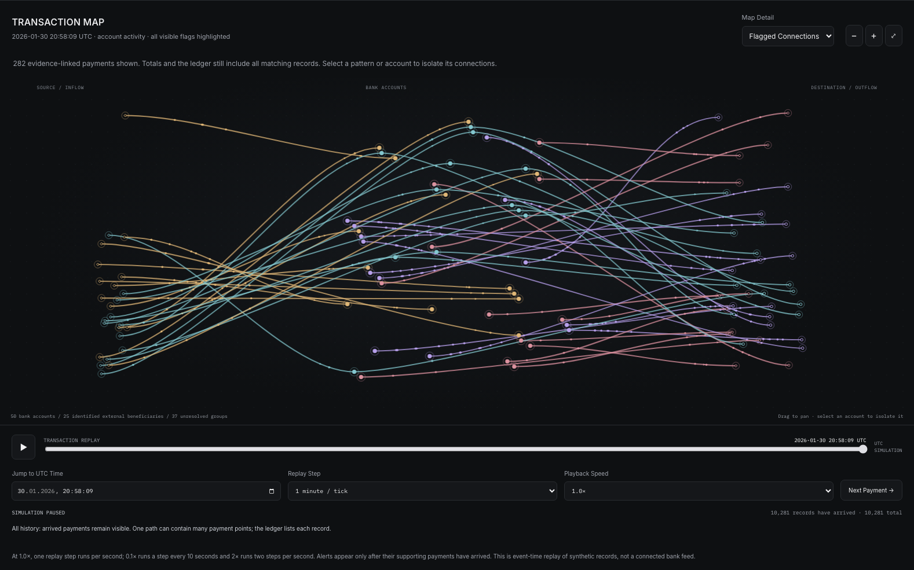
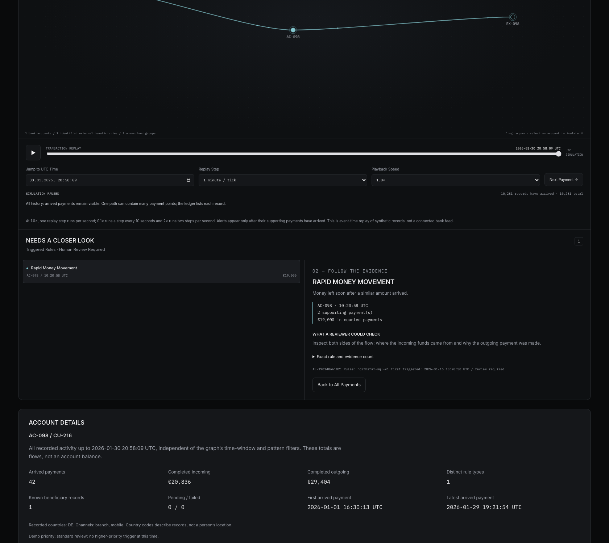
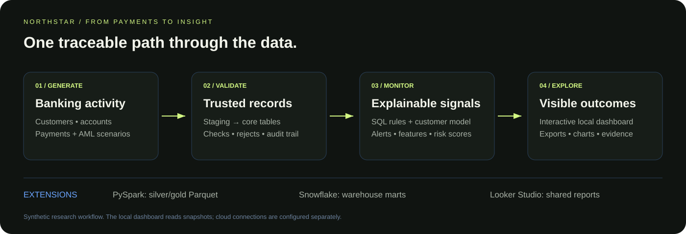
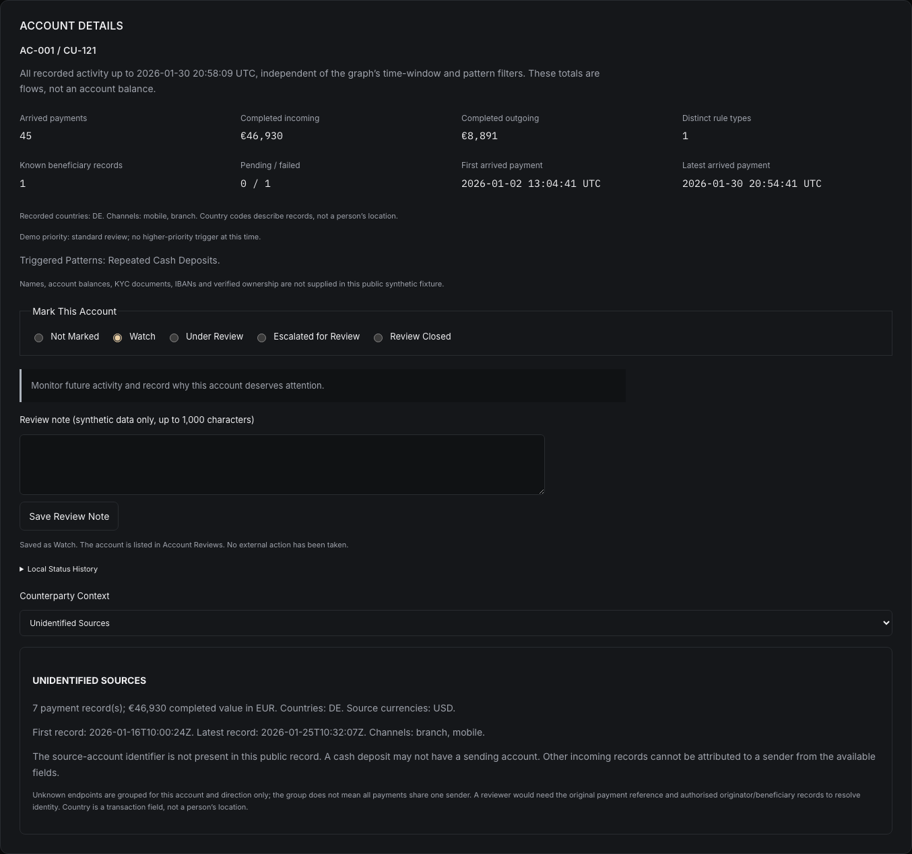

# ENTERPRISE AML COMPLIANCE PLATFORM

**Trace the payment. Explain the alert.**

NorthStar is a synthetic banking project that shows how transaction records become explainable anti-money laundering (AML) alerts. Follow payments between recorded accounts and beneficiaries, watch a suspicious pattern develop, and inspect the evidence behind each flag.

**[Open the transaction network →](https://nitinsinghdm.github.io/aml-network/)** · [Portfolio case study](https://nitinsinghdm.github.io/aml.html) · [Full setup](docs/operations/SETUP.md)

## TRY IT IN THREE STEPS

1. Select **Watch an alert form**. The view focuses on one synthetic account and replays its payments.
2. Watch the UTC clock. A payment burst raises an alert when the rule's threshold is reached.
3. Select the alert. Read why it appeared and inspect the exact payments counted by the rule.

Use **Next payment** to skip quiet periods, jump to an exact UTC second, or choose a second, minute or hour per replay step. Playback Speed offers 0.1×, 0.5×, 1.0×, 1.5× and 2×; 1.0× runs one selected step per second. Filter the last hour or 24 hours to examine a smaller slice of activity.

This is **simulated event-time replay**, not a live bank connection. Alerts use only evidence available at the displayed time. A flag means “review this pattern,” not “this is a crime.”

## START AN AML REVIEW

The transaction map has its own full-width section. It starts with **Flagged Connections** to keep attention on payments supporting detected patterns; **All Payments** restores the wider network. Totals and the ledger continue to show all matching records, so the map explicitly states how many evidence-linked payments it draws.

Four pattern cards show alert-group and affected-account counts at the replay time. Choose a pattern, or select **Start an AML Review**, to isolate an account and its evidence. The review order uses the documented demo priority and then the latest evidence update. It is not a probability that money laundering occurred.

This helps a reviewer answer three questions: **Which pattern triggered? Which payments support it? What should I check next?** The SQL rules detect review candidates; determining whether activity is laundering requires verified context and human investigation.

## WHAT THE NETWORK SHOWS

| On screen | Meaning |
|---|---|
| Solid account points | Synthetic bank accounts |
| Hollow points | Recorded external beneficiaries |
| Diamonds | Unidentified counterparties; no shared identity is assumed |
| Lines and payment points | Recorded payment connections and individual transactions |
| Coloured signals | The type of AML pattern, not a verdict or severity rating |
| Evidence ledger | Payments behind the selected alert, with counted and contextual rows separated |

The public fixture contains **10,281 transactions across 250 accounts**, with **74 account/day/rule alert groups** over the complete period. Completed payments are shown by default; failed and pending records remain inspectable. Counts change with your filters and replay time. Filter by country, source currency, transaction type, channel and direction. The fixture includes EUR, USD and GBP payments; totals and rule thresholds stay in EUR so they can be compared consistently. Open a payment to see its original amount. **Back to All Payments** clears the selection and filters while keeping the replay clock in place. Opening an alert restores its complete evidence, including records outside your previous filters.

## FOUR PATTERNS TO INVESTIGATE

| Pattern | What triggers a review |
|---|---|
| Repeated cash deposits | Several near-threshold deposits accumulate on one account |
| Payment burst | At least 10 completed payments within a trailing hour |
| Rapid money movement | Funds leave soon after a similarly sized incoming payment |
| Higher-risk corridor | A large cross-border payment involves a higher-rated fixture country |

Exact rules appear in the interface and in [SQL](sql/analytics/01_monitoring.sql). Thresholds and country ratings are demonstration assumptions. Alert amounts can overlap across rules and must not be summed as unique suspicious volume.

## HOW IT WORKS

**Generate → Validate → Monitor → Explain**

Python produces repeatable synthetic activity. PostgreSQL validates and ingests accepted records, tracks rejected rows and prevents duplicate loads. SQL identifies monitoring patterns. The browser links those patterns to payment evidence; the local analytics dashboard explores summaries and customer risk scores.

The original banking schemas, reference data and master-data generators are preserved.

| Component | What is available |
|---|---|
| PostgreSQL and Python | Reproducible generation, staging-to-core ingestion, quality checks and audited exports |
| Public browser interface | Transaction graph, second-resolution replay, point-in-time alerts, evidence and CSV export |
| Streamlit analytics | Local payment overview, alert exploration, customer scores and pipeline status |
| Risk-scoring ML | Synthetic customer classification with a separate holdout evaluation; real-world accuracy is unvalidated |
| PySpark | Typed silver/gold Parquet processing and reconciliation tests |
| Snowflake | Environment-configured warehouse loader; your account and live acceptance checks are required |
| Looker Studio | Compatible datasets and a setup guide; report publishing requires your account |
| GitHub Actions | Database, Spark, interface and browser checks; required integration check protects main |

## THE INVESTIGATION STORY

A synthetic customer makes several payments. Individually, they may look ordinary. Taken together, a burst, repeated cash deposits or a quick movement of incoming funds can deserve a closer look.

The platform first checks that each record is usable: references exist, required fields are valid and repeated loads do not duplicate payments. SQL then evaluates the monitoring rules. During replay, an alert appears only after the payments needed to trigger it have arrived.

Select **Watch an alert form** to follow one account. Several payments may share one line because they share endpoints. The counter measures payment records, not lines. The guided replay keeps arrived records visible and pauses when the payment-burst threshold is reached. In a rolling last-hour view, older payments disappear from the view as time advances; they have not been deleted or declared safe.

Select an account to inspect its incoming and outgoing flows, payment statuses, recorded beneficiaries and triggered rule types. These are transaction totals, not balances. Select an alert for its exact evidence, or a transaction ID for the individual payment. Unknown counterparties and missing owner information stay explicitly unknown.

A reviewer can mark an account **Watch**, **Under Review**, **Escalated for Review** or **Review Closed** using radio buttons, and add a short note. The **Account reviews** view brings those annotations together. Closing a review does not establish that an account is safe. Watch keeps an account on your follow-up list. Under Review records active investigation. Escalated for Review moves it to the top of the review list and requires a reason; Review Closed also requires a reason. The interface shows the next step and recent local status changes. Nothing is automatically sent to a bank, assigned to another analyst or used to block a payment. Notes are saved in this browser for the synthetic dataset and can be exported; they are not shared bank cases or an authenticated audit trail.

Optional sound draws attention to a new alert during replay. A tone means a rule has triggered; two higher tones mean a burst has reached 12 payments within an hour or a second distinct rule has flagged the same account. This is an explainable demonstration policy for review priority, not a validated measure of criminal activity. Sound starts only when enabled, and visual messages remain available. Adjust the volume or use Test Sound before playback; device volume also affects loudness.

## WHERE EACH PART FITS

The public network tells the transaction-level story. The separate local Streamlit dashboard explains aggregate activity, pipeline quality and synthetic customer scores. Python coordinates generation and exports; PostgreSQL supplies the validated records and monitoring logic. PySpark prepares analytical datasets. Snowflake loading and Looker Studio reporting are optional downstream integrations requiring your cloud setup.

For installation, commands and reproducibility, see the [setup guide](docs/operations/SETUP.md) and [network guide](docs/operations/NETWORK.md). The README focuses on what the project does; those guides explain how to run it.

## POTENTIAL VALUE FOR A BANK

The product hypothesis is **less time spent reconstructing why an alert appeared**. Each flag connects a versioned rule, its trigger time, the account and the exact payment evidence. Unknown counterparties remain explicit, and reviewers can distinguish counted payments from supporting context.

This is a proposed value proposition, not a proven market advantage. A bank pilot would need to measure analyst review time, false-positive workload and detection quality on representative data. Synthetic results cannot establish production readiness.

The current demo does not provide live bank ingestion, production access controls, tenant isolation or shared case management. It does not block payments. Broader cybersecurity and the separate SentinelPay product are future work.

## VERIFY AND EXPLORE

Database and Spark tests require the configuration in the [testing guide](docs/operations/SETUP.md#tests); unavailable integration dependencies are explicitly skipped. Browser checks cover filters, exact alert trigger times, evidence, export, replay and mobile layout.

- [Network meaning, replay contracts and browser checks](docs/operations/NETWORK.md)
- [Verification record](docs/operations/VERIFICATION.md)
- [Pipeline operations and recovery](docs/operations/RUNBOOK.md)
- [Snowflake configuration](docs/operations/SNOWFLAKE.md)
- [Looker Studio setup](dashboard/README.md)
- [Original database design](docs/database/Database-Design.md)

**Nitin Singh** · Data Analytics & Data Engineering · [Portfolio](https://nitinsinghdm.github.io/)
